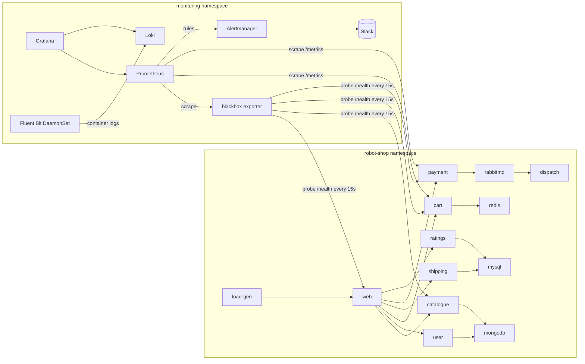

# Capstone 2: Observability and SRE for Robot Shop on EKS

Robot Shop (a microservices e-commerce demo) runs on the EKS cluster from Capstone 1. On top of it:
- metrics, dashboards and SLO-based alerts (Prometheus, Grafana, Alertmanager)
- centralised logs (Fluent Bit and Loki)
- a runbook and a postmortem from a failure drill

## Architecture



## What I changed in the upstream chart (K8s/helm)
| Change | Why |
|---|---|
| Removed the Instana agent env vars and the EUM config | No paid Instana backend; the vars caused noise in the logs |
| nodeport: true for web | Avoids a paid AWS LoadBalancer; reached with kubectl port-forward |
| Redis uses emptyDir, not a PVC | No EBS CSI driver on the cluster; demo data is disposable |
| Added service: cart label on the cart Service | So the ServiceMonitor can select it |

## Install
```powershell
kubectl create namespace robot-shop
helm install robot-shop K8s/helm -n robot-shop
kubectl apply -n robot-shop -f K8s/load-deployment.yaml
```
The full monitoring install, step by step, is in [INSTALL-MONITORING.md](INSTALL-MONITORING.md).

| Component | How it is installed | File |
|---|---|---|
| Prometheus, Grafana, Alertmanager | kube-prometheus-stack chart | monitoring/kps-values.yaml |
| Blackbox exporter | prometheus-blackbox-exporter chart | default values |
| Uptime probes | Probe CRDs | monitoring/probes.yaml |
| Business metrics | ServiceMonitor for cart and payment | monitoring/servicemonitors.yaml |
| SLO alerts | PrometheusRule | monitoring/slo-rules.yaml |
| Dashboard | ConfigMap, auto-loaded by the Grafana sidecar | monitoring/dashboard-configmap.yaml |
| Logs | Loki (single binary) and the Fluent Bit chart | monitoring/loki.yaml, monitoring/fluent-bit-values.yaml |

The Slack webhook is passed with --set from an environment variable. It is never committed to Git.

## SLOs and alerts
Details are in [SLO.md](SLO.md).
- **SLO:** web is available 99% of the time over 30 days, which gives a 7h 12m error budget.
- **RobotShopServiceDown:** any probe failing for 1 minute (critical).
- **RobotShopWebErrorBudgetFastBurn:** web failing at 14.4x the allowed rate, checked over both 5m and 1h windows (critical).
- Every alert has a runbook_url pointing at [RUNBOOK.md](RUNBOOK.md).

## Dashboard: Robot Shop - Golden Signals and SLO
| Signal | Panel |
|---|---|
| Latency | Probe duration per service |
| Traffic | Orders/min (sold_count_total) and cart adds/min (items_added) |
| Errors | Error rate per service (1 - probe_success) |
| Saturation | Built-in kube-prometheus-stack node and pod dashboards |
| SLO | Web availability now, error budget remaining, services down |

## Logs
Fluent Bit tails container logs on every node, keeps only the robot-shop namespace, and adds a level label (error, warn or info). It then ships to Loki with the labels namespace, pod, service and level.
Example query in Grafana Explore (Loki): {namespace="robot-shop", level="error"}

## Failure drill
1. kubectl scale deploy/web -n robot-shop --replicas=0 (simulated outage)
2. The web probe fails, RobotShopServiceDown goes Pending, then Firing after 1 minute, and the dashboard shows web at 0%.
3. Recovery: kubectl scale deploy/web -n robot-shop --replicas=1, and the alert resolves.
4. Written up in [POSTMORTEM.md](POSTMORTEM.md).

## Evidence
Screenshots are in docs/screenshots/:
- pods running
- storefront
- Grafana dashboard
- alerts inactive
- alert firing
- dashboard during the outage
- alert resolved

## Known limitations
- Slack receiver is configured, but the webhook was not connected for this submission. Alerts were verified in the Prometheus UI.
- Prometheus retention is 2 days, so the error-budget panel uses a 24h demo window.
- Loki and Redis use emptyDir, so their data is lost if the pod restarts.
- Distributed tracing is not set up yet.
- Runs on the shared Capstone 1 cluster (2x m7i-flex.large); destroy it with terraform destroy after grading.
